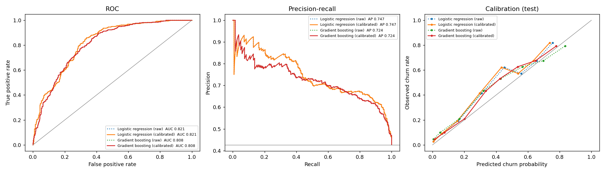
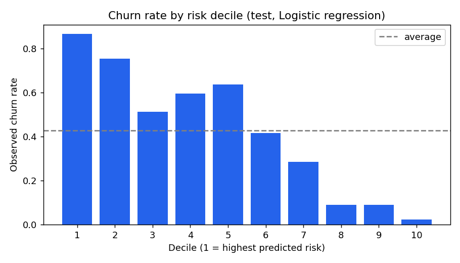
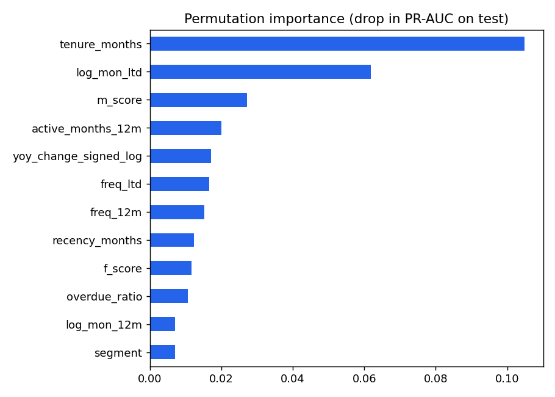

# Customer churn prediction (probabilistic classification)

Predicts, for each active service customer, the **probability of not buying again in the next 12 months**.
Built on the same demo data as `Customer_360_Dashboard` (fake customer IDs, perturbed amounts; see the main README).

## Problem framing

| | |
|---|---|
| Unit | One customer at one quarter-end snapshot (Mar / Jun / Sep / Dec) |
| Population | Customers with at least one invoice in the 12 months before the snapshot |
| Label | `churn = 1` when there is **no invoice in the 12 months after** the snapshot |
| Features | Recency, frequency and monetary value (12-month and lifetime), tenure, active months, average gap between purchases, overdue ratio (time since last purchase ÷ usual gap), year-on-year revenue change, average invoice value, RFM scores, RFM segment, customer type, industry section |
| Leakage control | Every feature uses only history up to the snapshot; snapshots whose 12-month window is not finished are scored but never used for training |

## Validation design

Split **by time**, never at random, so the test mimics predicting the future:

| Set | Snapshots | Rows | Use |
|---|---|---|---|
| Train | up to Dec 2022 | 2,481 | Fit the models |
| Calibration | 2023 | 499 | Calibrate probabilities (Platt / sigmoid) and choose the model |
| Test | Mar 2024 to Jun 2025 | 886 | Final, untouched evaluation |
| Score | Jun 2026 (latest) | 135 customers | Churn probability for action |

## Results (test period, churn base rate 42.7 %)

| Model | ROC-AUC | PR-AUC | Brier | Log loss | Top-10 % lift |
|---|---|---|---|---|---|
| **Logistic regression (calibrated), selected** | **0.821** | **0.747** | **0.175** | **0.520** | **2.0×** |
| Gradient boosting (calibrated) | 0.808 | 0.724 | 0.179 | 0.527 | 1.8× |
| Always predict the base rate | 0.500 | 0.427 | 0.246 | | 1.0× |

- The 10 % of customers with the highest predicted risk churned at **87 %** (2.0× the average); the top 30 % hold **50 %** of all churners.
- The bottom 30 % churned at only **2–9 %**, so they can safely be left out of retention campaigns.
- Logistic regression beat gradient boosting: with about 400 customers, a simpler model generalises better, and it is easier to explain.
- Most important features (permutation importance): tenure, lifetime spend, monetary score, active months in the last year, and year-on-year revenue change.





## Files

| File | What it is |
|---|---|
| `churn_model.py` | The whole pipeline: labels, features, time split, models, calibration, evaluation, scoring |
| `data/rfm_monthly_demo.csv` | Monthly RFM snapshots per customer (demo) |
| `data/customers_demo.csv` | Customer type and industry section (demo) |
| `outputs/metrics.json` | All metrics for every model |
| `outputs/churn_scores.csv` | Churn probability and risk band (High ≥ 0.50, Medium ≥ 0.25, Low) per active customer at the latest snapshot; ready to load into Power BI |
| `outputs/*.png`, `outputs/*.csv` | Charts, lift table, feature importance |

## Run

```bash
pip install -r requirements.txt
python churn_model.py
```

## Limitations

- The demo sample is small (387 customers with labels), so the metrics have wide uncertainty; the same code runs on the full customer base.
- Quarter-end snapshots of the same customer are correlated; the time split keeps the test honest, but the effective sample is smaller than the row count.
- Churn is defined by invoices only; a customer may still be in contact through other channels.
