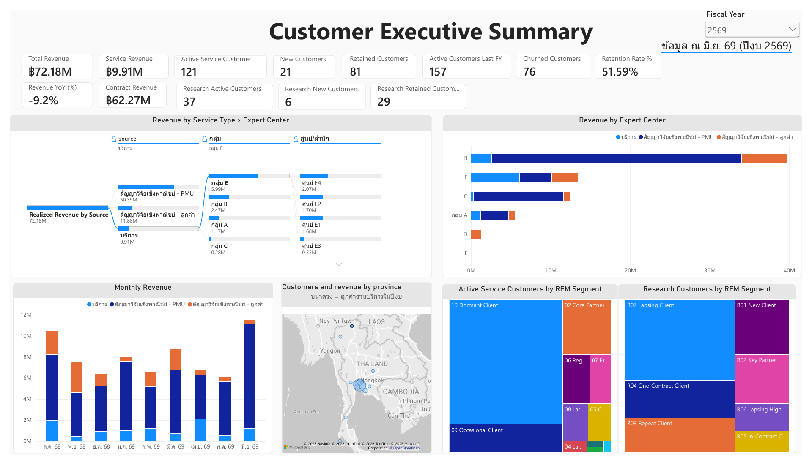
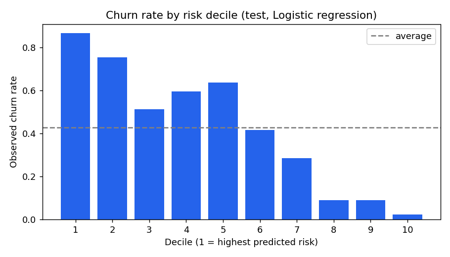
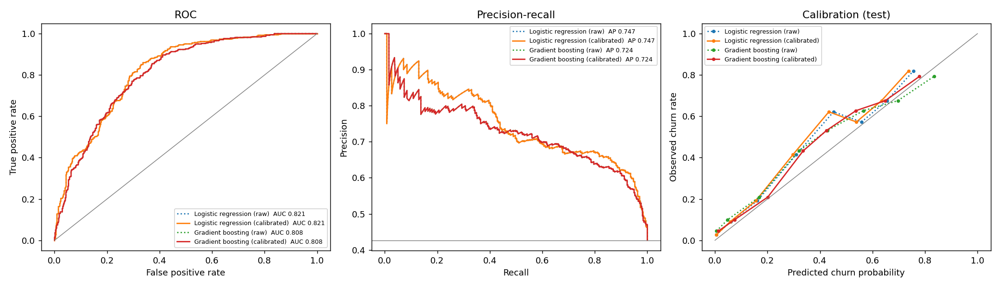
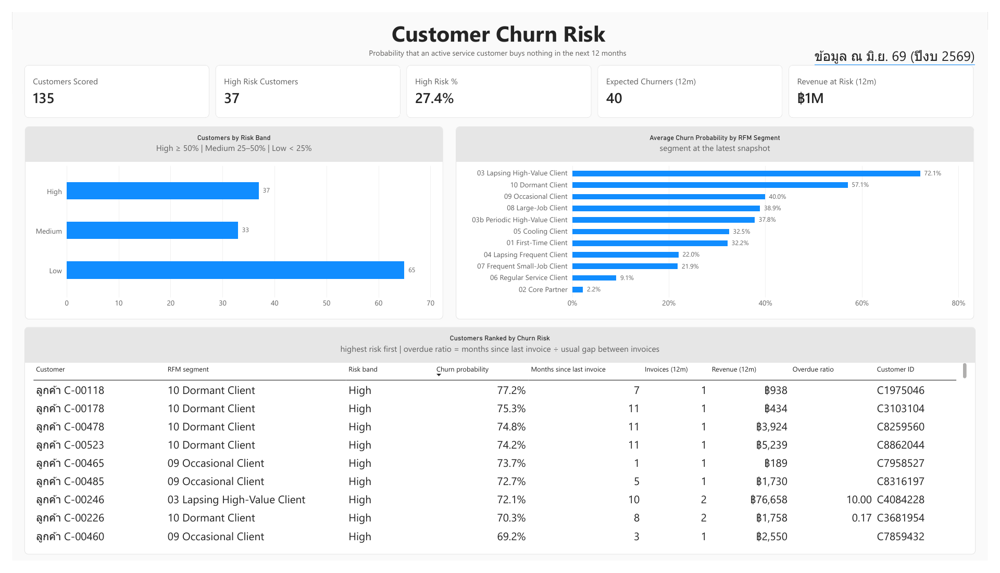
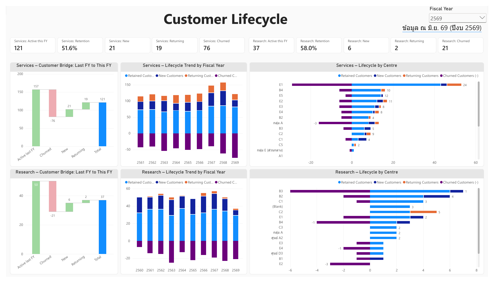
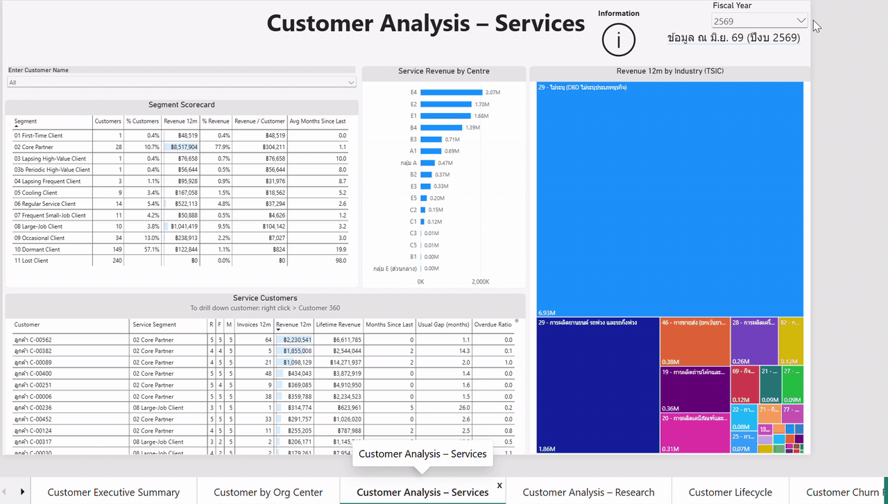
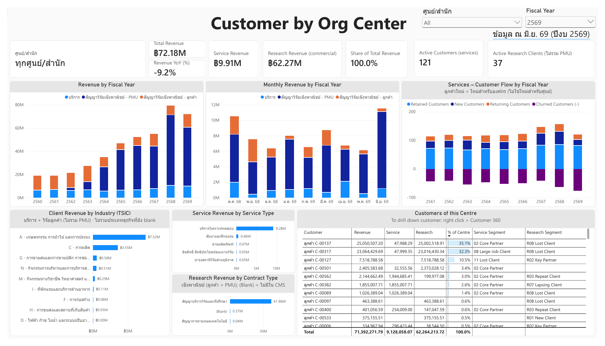
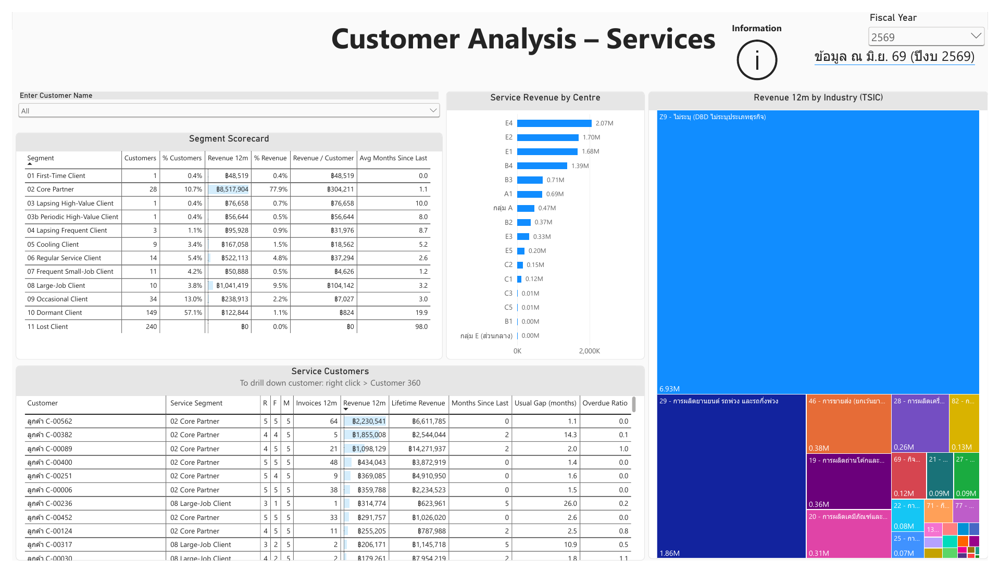
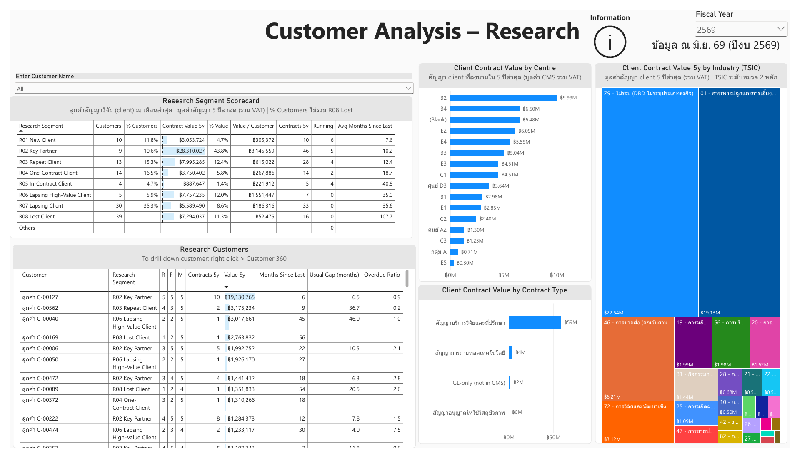
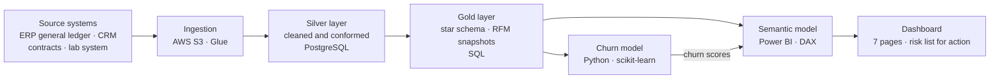

# Customer 360 and Churn Prediction

In this project I built a customer dashboard for a research and testing institute, and a model that predicts which customers will stop buying.

The institute earns money in two ways: lab and testing services, paid per job, and research contracts with companies and funding agencies. The customer data was spread across the accounting system, the contract system and the lab system, so nobody could answer simple questions like "how many customers did we keep this year?" or "which customers are slipping away?". I wanted to bring everything into one model, group customers by how they actually buy, and flag the ones at risk early enough to do something about it.

The project has two parts:

* [`Customer_360_Dashboard`](Customer_360_Dashboard): a Power BI project with 7 pages, from an executive summary down to a single customer.
* [`Churn_Prediction`](Churn_Prediction): a Python model that gives every active service customer a probability of buying nothing in the next 12 months. Its scores feed the dashboard's Churn Risk page.



**About the data.** The original work used real company data, so everything here is anonymised. Customers, project leaders and projects are numbered labels, IDs are fake, the organisation is shown as letters (`กลุ่ม A`, `ศูนย์ B2`), tax numbers and addresses are masked, and amounts come from a sample of records multiplied by random factors. The numbers below describe the demo data, not the real organisation.

## Results

* A small group of customers carries the business. About one active service customer in five buys regularly and brings in about three quarters of the service revenue, and these customers almost never leave.
* Most customers buy once or twice a year for small amounts, and about 4 in 10 of them don't come back the following year.
* Churn can be predicted. The model ranks customers well (ROC-AUC 0.82), and the 10% it rates riskiest churned at twice the average rate (87%).
* The safest customers are easy to spot too. The bottom 30% churned at only 2-9%, so they can be left out of retention campaigns.
* A simple model was enough. Logistic regression beat gradient boosting on this data, and it is much easier to explain to the people who will act on it.

Results on the test period (Mar 2024 - Jun 2025, when 43% of customers churned):

|Model|ROC-AUC|PR-AUC|Brier score|Churn rate in top 10%|
|-|-|-|-|-|
|Always predict the average (baseline)|0.50|0.43|0.246|43%|
|Gradient boosting (calibrated)|0.81|0.72|0.179|79%|
|Logistic regression (calibrated)|**0.82**|**0.75**|**0.175**|**87%**|

To put that in practice: if the retention team only has time to call a few customers, picking them from the top of the model's list instead of at random roughly doubles the share of calls that go to customers who would really have left. On the latest snapshot (Jun 2026) the model scores 135 active service customers, puts 37 of them in the high-risk band, and expects about 40 to churn in the next 12 months.





## How I tested the churn model

A customer counts as churned if they have no invoice in the 12 months after a snapshot. For the most recent snapshots those 12 months haven't finished yet, so I only score them and never train on them. All features are calculated from data up to the snapshot date.

I split the data by time instead of at random. The model is trained on snapshots up to 2022, I used 2023 to calibrate and to pick between logistic regression and gradient boosting, and I kept Mar 2024 - Jun 2025 for the final test only.

I calibrated the probabilities because the dashboard adds them up. If the model says 30%, about 3 in 10 of those customers should actually leave, otherwise "expected churners" and "revenue at risk" on the Churn Risk page would be wrong.

More detail is in [`Churn_Prediction/README.md`](Churn_Prediction/README.md).

## The dashboard

|Page|What it answers|
|-|-|
|Customer Executive Summary|How much revenue, how many active, new, retained and churned customers, and the retention rate|
|Customer by Org Center|The same picture for one centre and its share of the total|
|Customer Analysis - Services|RFM segments of service customers (recency, frequency, monetary value) and revenue by service type|
|Customer Analysis - Research|RFM segments of research-contract customers and revenue by contract type|
|Customer Lifecycle|New, returning and lost customers each year, and the bridge from last year's customers to this year's|
|Customer Churn Risk|Every active customer ranked by churn probability, expected churners and revenue at risk|
|Customer 360|Drill-through for one customer: profile, revenue history, contracts and segment over time|

All 7 pages are in [`Customer_360_Dashboard.pdf`](images/Customer_360_Dashboard.pdf).

**Customer Churn Risk**: the churn model's scores, ready for the retention team



**Customer Lifecycle**: how many customers we kept, lost, won and won back each year



**Customer 360**: right-click any customer on another page and drill through to their full profile



[Watch as video (MP4)](images/drill_through_demo.mp4) · [Static screenshot](images/07_customer_360.png)

<details>
<summary>More pages: Org Center, Services, Research</summary>







</details>

Behind the dashboard is a star schema with two layers: `silver` for cleaned source data and `gold` for reporting tables. Revenue is stored at invoice-line level, and customer behaviour is stored as monthly RFM snapshots so I can track how a customer's segment changes over time.



## Use of AI

I designed the data model, wrote the business rules (which revenue counts, how customers are attributed, how segments are defined) and built the Power BI model and dashboard.

To publish this version I decided what had to be hidden: customer and project names, tax numbers, addresses, organisation units and real amounts. I used Claude (an AI assistant) to help write the masking scripts for those rules, then went through the model, the report pages and the screenshots myself and fixed the leftovers it had missed, such as internal unit names.

## Limitations

* The demo data is a small sample (about 400 customers with a known outcome), so the results have wide uncertainty. The same code runs on the full customer base.
* Snapshots of the same customer from different quarters are related, so the real sample is smaller than the row count.
* Churn is defined by invoices only. A customer can still be in touch through other channels without buying.

## How to run

**Dashboard**: open `Customer_360_Dashboard/Customer_360_Dashboard.pbip` in Power BI Desktop (2025 or later) and click **Refresh**. The data is built into the model, so there is nothing to connect. If the first refresh says "A cyclic reference was encountered", click Refresh again; this is a known Power BI Desktop issue.

**Churn model**:

```bash
cd Churn_Prediction
pip install -r requirements.txt
python churn_model.py
```


Nawa Penparkgoon
